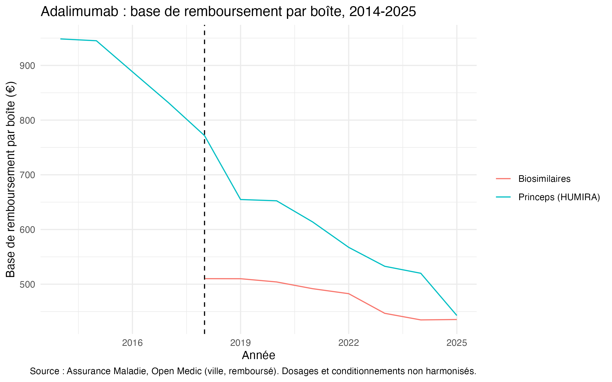
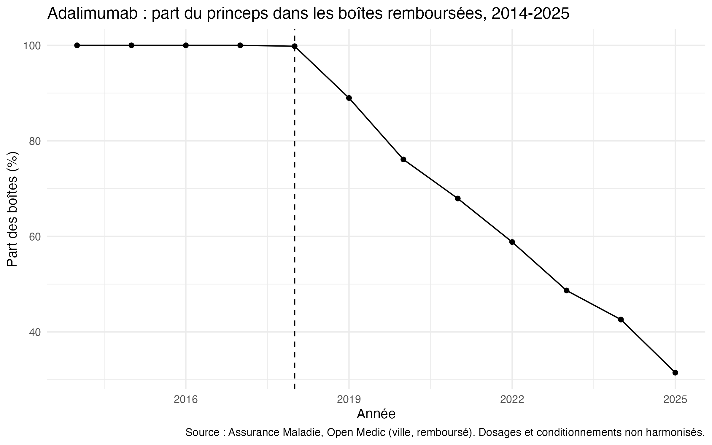

# Adalimumab : princeps et biosimilaires en ville (Open Medic, 2014-2025)

## Question

Comment ont évolué, depuis 2014, les volumes, la base de remboursement par boîte et
la part du princeps (HUMIRA) pour l'adalimumab, avant et après l'arrivée des
biosimilaires ? Que rapporterait aujourd'hui à l'assurance maladie une substitution
totale du princeps restant par des biosimilaires ?

## Données

- **Open Medic** (Assurance Maladie) : fichiers annuels 2014 à 2025, médicaments
  délivrés en pharmacie de ville et remboursés. Données agrégées : boîtes (`BOITES`),
  montant remboursé (`REM`), base de remboursement (`BSE`), par code CIP13, âge,
  sexe et région.
- **Fichier descriptif des variables d'Open Medic** : définitions des variables et
  tables de correspondance codes / libellés.
- Les fichiers bruts ne sont pas versionnés (volumineux) : à télécharger sur
  data.gouv.fr / ameli.fr et à placer dans le dossier de travail sous le nom
  `OPEN_MEDIC_AAAA.csv`. <!-- À COMPLÉTER : liens exacts -->

## Méthode

Tout le traitement est dans `script_adalimumab_open_medic.R`. Les choix de méthode
et les difficultés rencontrées :

1. **Périmètre.** L'adalimumab est repéré par son code ATC5 (`L04AB04`), identique
   dans tous les fichiers. Un premier filtre sur le libellé (`L_ATC5`) a été
   abandonné : cette colonne n'existe pas dans les fichiers anciens.
2. **Nombres au format français.** `REM` et `BSE` sont lues en texte (point pour les
   milliers, virgule pour les décimales). Une fonction les convertit en numérique
   et ne touche pas une colonne déjà convertie : relancer le nettoyage deux fois
   multipliait les valeurs par 100.
3. **Marques et statut.** Les fichiers à partir de 2018 contiennent le libellé de
   chaque présentation (`l_cip13`) : la marque est son premier mot (HUMIRA est le
   princeps, les autres marques sont des biosimilaires, une marque non identifiée
   est mise à part).
4. **Années sans libellé (2014 à 2017).** Seuls les codes sont disponibles. Ni la
   base publique des médicaments ni le fichier descriptif ne permettent de les
   nommer : les références d'avant 2018 ne figurent plus dans ces tables. On
   applique donc une hypothèse : les biosimilaires de l'adalimumab n'ayant été
   commercialisés qu'à partir d'octobre 2018, tout l'adalimumab de ces années est
   du princeps. <!-- À COMPLÉTER : source primaire de la date de commercialisation -->
5. **Une fonction par fichier, une boucle pour toutes les années.** La fonction
   `traiter_fichier_open_medic()` traite un fichier ; l'année est lue dans son nom ;
   les résultats sont empilés dans un seul tableau (une ligne par marque et par
   année). Des contrôles arrêtent le traitement si une colonne attendue manque ou
   si un fichier ancien est utilisé après 2018 sans libellés.
6. **Indicateurs par année.** Prix moyen pondéré par statut (base de remboursement
   divisée par le nombre de boîtes), écart relatif entre biosimilaires et princeps,
   part du princeps dans les boîtes.
7. **Économie potentielle d'une substitution totale** (budget impact simplifié) :

   ΔC = Q × (s_scen − s_obs) × (c_ref − c_bio)

   où Q est le volume total de boîtes, s la part de biosimilaires (observée ou
   visée, 100 % pour une substitution totale) et c le prix moyen par boîte du
   princeps (ref) et des biosimilaires (bio). Elle mesure ce qui resterait à
   gagner à l'écart de prix de l'année, pas des économies déjà réalisées.

## Résultats

<!-- À COMPLÉTER : analyse des résultats -->





## Limites

<!-- À COMPLÉTER ensemble -->

## Reproduire

1. Installer R et le package `tidyverse`.
2. Ouvrir le dossier du projet comme projet RStudio et y placer les fichiers
   `OPEN_MEDIC_AAAA.csv`.
3. Exécuter `script_adalimumab_open_medic.R` d'un bloc : il produit le tableau des
   indicateurs et enregistre les graphiques dans `outputs/figures/`.

## Structure du dépôt

```
README.md
script_adalimumab_open_medic.R
outputs/figures/      graphiques (PNG)
```
